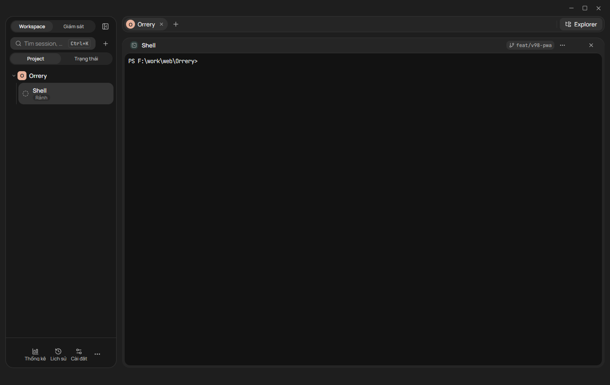

# Orrery

App desktop (Windows, macOS) để theo dõi và chạy các session Claude Code CLI cùng các lần Codex CLI do chúng gọi, ngay trong một Workspace có terminal, editor, Git và Run. Chạy hoàn toàn trên máy, không gọi API.

Từ 4.0 app chạy bằng Tauri + Rust (`orrery-core`), RAM khoảng một nửa bản Electron cũ (số đo ở `docs/perf/`). Tên cũ: Claude Code Monitor, Agent Monitor, GolAIm; mã nội bộ giữ nguyên (`dev.ccm.monitor`, data `ccm`, biến `CCM_*`) nên bản cũ cập nhật thẳng.



## Tính năng chính

**Workspace**
- Pane Claude Code, Codex, shell: tab, chia ô, phóng ô, hoàn tác đóng (`--resume`), khôi phục sau khi tắt app.
- Rail session sống theo project hoặc trạng thái; Inbox (`Ctrl+Shift+A`) gom xin quyền, câu hỏi, lỗi; `Ctrl+K` tìm session, file, lệnh.
- Trả lời menu chọn của Claude / Codex bằng chuột ngay trên pane.
- Bảng **MCP & plugin** trong menu session: bật / tắt theo project, số lần gọi trong session, một nút Áp dụng.

**Giám sát**
- Bảng session theo Cần chủ nhân / Đang chạy / Rảnh, Quỹ đạo (subagent quanh agent chính), Usage và History.

**Explorer, Git, Run**
- Explorer icon Atom Material, editor có tự lưu, Changes (diff, stage từng đoạn), Git Log và nhánh, push / pull bằng nhiều tài khoản GitHub.
- Run pane Android / Flutter bắt crash, XML Layout Preview, tab Thiết bị (adb qua USB / Wi-Fi).

**Remote**
- App Android và web app iPhone / iPad: hộp thư session, màn chat (gửi thẳng vào session, nút Dừng, bấm nút để trả lời xin quyền), xem terminal.
- Kết nối LAN hoặc qua relay Cloudflare của chính bạn, mã hoá đầu cuối (Noise); relay dựng 1 chạm bằng wrangler.
- Push có nội dung đã che secret; Telegram bot nhận báo cáo và lệnh.

**Khác**
- Disk: quét, tìm, dọn ổ đĩa (xoá luôn qua hộp xác nhận, mặc định vào Thùng rác).
- Giao diện Sương kính, bảng màu Sương kính, Than chì, Đen trắng, Ngân hà, Orrery, Tuỳ chỉnh, Ngẫu nhiên (mỗi lần mở app trộn 1 bảng màu mới); tiếng Việt / English.

## Cài đặt

Tải bản mới nhất ở [GitHub Releases](https://github.com/JLSoft-Together/Orrery/releases).

| Hệ điều hành | File |
|---|---|
| Windows 10 / 11 | `Orrery-Setup-<ver>.exe` (NSIS, không có bản Portable từ 4.0) |
| macOS Apple Silicon / Intel | `Orrery-<ver>-arm64.dmg` / `Orrery-<ver>-x64.dmg` |

- **Windows**: exe chưa ký số. SmartScreen cảnh báo lần đầu: **More info > Run anyway**. Đóng cửa sổ = ẩn xuống tray.
- **macOS**: app ký ad-hoc, chưa notarize. Kéo vào Applications, mở, bị chặn thì **System Settings > Privacy & Security > Open Anyway**, hoặc `xattr -dr com.apple.quarantine "/Applications/Orrery.app"`.
- Cần Claude Code CLI `2.1.289` (bản khác vẫn chạy, có cảnh báo). Mở app rồi chạy `claude` ở terminal bất kỳ, session hiện lên trong khoảng 1 giây.
- **Điện thoại**: Cài đặt > Remote > Điều khiển từ xa: bật, thẻ **Cài app lên điện thoại** (Android: QR tải APK qua Wi-Fi; iPhone: QR mở `<relay>/app/`, rồi Thêm vào MH chính), sau đó **Thêm điện thoại** để ghép bằng QR. Chi tiết: `docs/orrery-remote.md`.

Gặp lỗi: Cài đặt > Cập nhật & trợ giúp > Chẩn đoán, lưu file log để gửi kèm.

## Build từ source

Cần Node.js `20.19+` hoặc `22.12+`, Rust stable (`rustup`); macOS thêm Xcode Command Line Tools.

```sh
npm install
npm run shell:dev   # build web rồi chạy app Tauri (dev)
npm run dev         # chỉ làm UI: collector --dev + Vite (127.0.0.1:5173)
npm run qa          # gate nhanh theo git diff: typecheck, vitest related, cargo test, E2E liên quan
npm run dist        # đóng gói cho OS đang chạy (Windows: NSIS, macOS: dmg arm64 + x64), không cross build
```

E2E (`npm run e2e -w @ccm/desktop`) chạy trên Windows (WebView2) và macOS (cổng CDP giả cho WKWebView, chỉ bản dev). Bộ cài ra `apps/shell/release/`. Cấu trúc repo, E2E, app điện thoại (`apps/mobile`), relay (`apps/relay`) và mọi lệnh khác: `CLAUDE.md`.

## Biến môi trường

| Biến | Mặc định | Ý nghĩa |
|---|---|---|
| `CLAUDE_CONFIG_DIR` | `~/.claude` | Thư mục data Claude Code |
| `CODEX_HOME` / `CCM_CODEX` | `~/.codex` / `1` | Data Codex; `CCM_CODEX=0` tắt theo dõi Codex |
| `CCM_DATA_DIR` | `%LOCALAPPDATA%/ccm` (macOS `~/Library/Application Support/ccm`) | Cache, tên session, log |
| `CCM_PORT` | `4317` | Port collector |
| `CCM_REMOTE_PORT` | `4320` | Port LAN cho điện thoại |
| `CCM_TOAST` | `1` | `0` = tắt toast / cảnh báo hệ thống |

Các biến còn lại (chọn core Rust / Node, DeepSeek, test): `CLAUDE.md`.

## Nguyên tắc

- **Chỉ local**: collector bind `127.0.0.1` và từ chối request không mang khoá của app; điện thoại chỉ nối sau khi ghép và được bạn cho phép.
- **Không tốn thêm token**: không gọi API, không chạy LLM khác. Chỉ gửi prompt khi bạn yêu cầu (Compact, tin từ điện thoại hoặc Telegram, nút trả lời menu); danh sách ngoại lệ ở `CLAUDE.md`.
- **Secret không rời máy**: env, khoá app, token PTY không gửi ra ngoài; nội dung push, Telegram, chat điện thoại đều che secret. Token GitHub, relay cất trong Keychain / Credential Manager.
- Token chỉ hiện khi có số liệu thật; Remote, Telegram, push mặc định tắt.

## Thư viện bên thứ ba

- [Habblaud](https://github.com/marmottajr/habblaud) (MIT): Office pixel-art, vendored trong `packages/habblaud`.
- [GramJS](https://github.com/gram-js/gramjs) (MIT): gửi file lớn qua Telegram MTProto.
- [Atom Material Icons](https://github.com/AtomMaterialUI/iconGenerator) (MIT): icon file / thư mục.
- [escrcpy](https://github.com/viarotel-org/escrcpy) (Apache-2.0): tham khảo cho tab Thiết bị, bản sao trong `src/escrcpy`, không build vào app.
- Font mở kèm app: SIL OFL / Ubuntu Font Licence, xem `apps/web/public/fonts-LICENSES.txt`.

## Giấy phép

[MIT](LICENSE). Thư viện bên thứ ba giữ giấy phép riêng như liệt kê ở trên.
